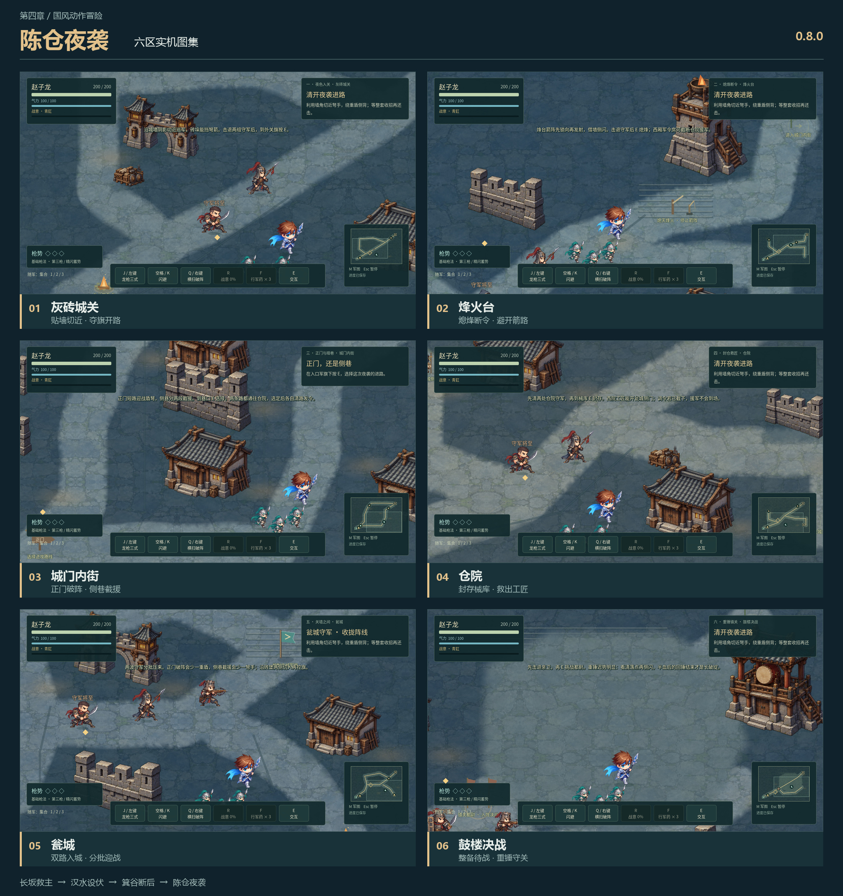

# 龙胆：逆命三国

**重生之我在三国当赵子龙**。操控 Q 版赵云，长坂救主，汉水设伏，箕谷断后，陈仓夜袭。当前开发版 **0.9.0 · 第一章品质样板**，保留四章、二十四个区域、24 种独立兵卒与 5 位将领。

仓库只维护 **Godot 4.7.2 / GDScript** 这一套游戏。在线版与 Windows 本地版由同一工程导出，关卡、角色、地图与技能一致；进度分别保存，不跨浏览器或设备自动同步。

0.9.0 集中打磨赵云动作、输入与命中反馈、长坂敌人站位和六区演出，具体范围见 [第一章品质样板](docs/CHAPTER-1-QUALITY-SLICE.md)。已完成38组整合回归、后续收尾专项、实机图形、原生短样本和Windows/Web正式包检查；浏览器基本操作已通过，线上部署核对仍待补，见 [开发记录](CLOUD-POLISH.md)。0.8.0 的发布成绩保留为历史；约 10–15 分钟是样板体验目标，尚非人工通关实测。

## 开始游戏

- 在线：[开始游戏](https://cy642.github.io/longdan-game/)。首页直接进入 Godot 游戏加载页，点击「开始游戏」；首次载入需要下载引擎与素材，使用电脑键盘与鼠标。
- Windows：导出后运行 `builds/windows/Longdan.exe`，无需安装 Godot 或联网。构建包保存在本地 `builds/`，不纳入源码仓库。
- 编辑器：在 Godot 4.7.2 中导入 `godot/project.godot`，按 F5 运行；也可使用 `Open-Godot.cmd` 指定本机引擎。
- 标题可选择四章、普通/剧情难度，继续、重玩或查看所选章节战报。前三章战报依次进入下一章；目标章节已有进度时恢复原检查点，已完成时打开该章战报。第四章为当前终章。

## 操作

| 行动 | 键盘 / 鼠标 |
|---|---|
| 移动 | WASD / 方向键 |
| 龙枪三式 | J / 鼠标左键，可按住连续出枪 |
| 闪避 | 空格 / K，消耗 16 气力 |
| 横扫破阵 | Q / 鼠标右键，消耗 30 气力，可破盾 |
| 青釭断势 | R，夺剑后满战意发动 |
| 行军药 | F；服药会被受击打断，营火补满三份 |
| 救援 / 休整 / 前进 | E |
| 集合 / 守点 / 冲阵 | 1 / 2 / 3 |
| 黄忠援射 | 北山接应战靠近黄忠按 3，冷却 6 秒 |
| 军图 / 暂停 / 全屏 | M / Esc / F11 |

键盘出枪优先锁住近处敌人，鼠标出枪跟随指向。第三枪真实命中或精准闪避积累「枪势」，满三格后强化下一次 Q。营火可选择连锋或游龙战法。随军负责牵制，赵云需要亲自完成击杀；敌人红区、破势和收招提示对应实际出手与反击窗口。暂停中可单独关闭脚步声。

## 四章内容

第一章沿「溃军山道 → 荒村小巷 → 破庙夺剑 → 井畔旧宅 → 粮道岔口 → 北桥决战」推进，包含夏侯恩与张郃单挑，以及救百姓、保糜夫人、截粮道三条可选命运。

第二章沿「汉水林道 → 北山粮道 → 乱石归途 → 孤营大门 → 河湾反击 → 铁营决战」推进：接应黄忠、护送粮车、藏兵开门、抓住擂鼓战机，再决战铁面督军。可焚毁火箭辎重、回救张著与伤兵；完成空营计并通关解锁「龙胆·回澜」。

第三章沿「雾锁箕谷 → 崖台军报 → 断崖栈道 → 石门拒敌 → 断索危桥 → 谷口决战」推进：夺旗停止箭阵，清路后两次下令撤军，守住石门，再选择断索截敌或留桥接应。断索会减少谷口一名弩兵；留桥多迎战两名追兵，再亲手接回末队。军报支线实际减少石门一名弩兵，辎重支线在谷口营火提供一次额外行军药。最终单挑原创敌将「玄甲先锋」，辨认长戟点阵、锁向冲锋与迟势回扫。箕谷具体剧情与敌将为游戏演绎。

第四章沿「灰砖城关 → 烽火台 → 城门内街 → 仓院 → 瓮城 → 鼓楼决战」推进。熄烽后选择正门短路破盾，或侧巷分两战截援；路线分别减少瓮城一名重盾或弩手。取调令可以阻止尚未到场的仓院援军，救工匠可打开瓮城东南侧门，仍需完成主战斗。鼓楼前可回访，明确确认迎战后再锁定决战；击败双手重锤首领「镇关都尉」后，亲自 E 收旗结算。陈仓夜袭为本作架空逆命剧情，具体战事和敌将均为游戏演绎。见 [第四章设计稿](docs/CHAPTER-4-CHENCANG.md)。

四章分别保存检查点、战法、支线和战报，重玩只重置所选章节。首次从前章战报续入承接难度、战法与已解锁回澜；恢复既有章节保留其原选择。回澜在第二至第四章暂停页切换。旧 Godot v1、旧两章与三章 v2 存档可读，缺少新章字段时使用未完成默认值，继续写入现有 v2 格式；原 v1 文件保留。保存失败时界面会提示本会话暂存。

本轮用普通敌人整套招式的起手机会和整套结束后的休息间隔，逐区增加压力；保留旧敌兵与将领的生命、伤害、招式前摇、命中窗口和锁向规则。剧情难度留出更长间隔。具体数值、调用边界及维护方法见 [难度曲线](docs/DIFFICULTY-CURVE.md)，尚待完整实玩校准。

## 当前画面与后续开发

**0.9.0 第一章品质样板（2026-10-27）**：赵云沿原有方向原画增加交替落脚、身体重心、蓄势压枪与收招回正；保持已校准人体尺寸、脚锚和完整兵器。闪避残影复制当时的变形网格。轻枪、第三枪、回马枪、盾挡和破盾／破势使用不同命中火花与音色，空挥只留下风声；同一招群体命中限制音量叠加。0.14 秒晚输入按实际可衔接时刻消费，冷却结束前不提前获得位移或招式时间，无资源误按不会擦掉已接受的动作。

长坂敌兵会在原有攻击规则下调整肩侧、枪距与弓手射线；山道碎石、荒村焦土、庙前苔石、井院水迹、粮道田垄和北桥湿岸强化区域差异。局部烟尘、落叶、水光与暖灯随剧情变化，地名和结果字幕不阻断操作。原伤害、精准闪避窗口、四章难度顺序与存档任务合同保持。浮字现在避让状态条，重复破盾喊字由常驻状态提示替代。以下为本轮受控实机图，不是完整人工通关录像。


[查看赵云0.8/0.9动作动态对照（7秒）](docs/images/zhaoyun-motion-0.9.0.gif)：四方向、前后各140帧归格动作采样；沿用原画的网格动画，非新绘逐帧、非实战录像。后面的0.8.0与更早图片保留为历史。

**0.8.0 陈仓夜袭（2026-10-26）**：新章使用灰砖城墙、瓦顶仓房、烽台、城门、鼓楼与夜间灯火构图，六张独立烘焙地表及六种建筑原画组成专用图集；场景与长坂村野、汉水军寨、箕谷崖谷区分。新增六种陈仓兵卒和重锤都尉完整原画，包括西厢调令弩卫。当前共 29 种独立角色档案、六张敌军图集，仍使用固定人体比例、靴底锚点与刚性脸部/兵器保护。素材记录见 [陈仓角色提示词](godot/art_source/characters/CHENCANG-ART-PROMPTS.md)。



[查看六区原图](docs/images/chencang-0.8.0.jpg) · [镇关都尉重锤招式预警对照](docs/images/chencang-boss-0.8.0.jpg)。以下 0.7.0 / 0.6.0 图片保留为前版对照。

**0.7.0 三章敌军重绘（2026-10-25）**：18 种独立兵卒与 4 位将领，按长坂追兵、汉水营军、箕谷山阵分配完整原画。荒村刀手、北山辎重弩手、崖台号旗弩卫有专门形象；圆盾、塔盾、双刀、弩、枪与戟不再依靠旧身体叠加附件。人物按人体高度与靴底校准，长武器和旗帜不再压小身体。设计、十八区配置和制作约定见 [敌军美术规范](docs/ENEMY-ART-DIRECTION.md)，原画来源见 [生成提示词](godot/art_source/characters/ENEMY-REDESIGN-PROMPTS.md)。本轮不改变命中窗口、伤害数值、波次或旧存档。

[三章敌兵与将领实机图鉴（0.7.0）](docs/images/enemy-roster-0.7.0.png)

**0.6.0 箕谷断后（2026-10-23）**：第三章增加冷灰崖壁、横向栈道、旧石门、断索危桥与谷口岩台，使用六张独立烘焙地表和箕谷景物图集。沿用 0.5.0 可追溯的绘画原图与固定角色脚锚，按新地形重新构图；第三章地图不复用汉水地表。素材与重建顺序见 [绘画环境管线](docs/PAINTED-ENVIRONMENT.md)，[0.5.0 六区实机图](docs/images/map-materials-0.5.0.jpg) 仅作前版画面对照。

[第三章六区实机概览（0.6.0）](docs/images/jigu-0.6.0.jpg)

四章主路、第三章两种桥头路线、第四章两种进攻路线及支线已接入。赵云与敌军目前都沿用既有原画及网格动作，0.9.0 没有新增独立八方向逐帧手绘素材；完整过场与音乐仍待制作。第一章 10–15 分钟、第三章 18–25 分钟、第四章 18–24 分钟均为设计目标，尚非完整人工通关实测。后续从 [当前开发交接](docs/DEVELOPMENT-HANDOFF.md) 继续；其他玩法约定见 [可玩性计划](docs/PLAYABILITY-PLAN.md)、[第二章设计稿](docs/CHAPTER-2-HANSHUI.md) 和 [第三章设计及实施对照](docs/CHAPTER-3-JIGU.md)。

## 开发、构建与验证

- 游戏入口：`godot/scenes/main.tscn`。四章关卡数据为 `godot/data/chapter1.json` 至 `chapter4.json`；第一章局部地标与碰撞补充为 `godot/data/map_details.json`。箕谷由 `jigu_director.gd` 调度；陈仓的 `chencang_director.gd` 复用有限出兵队列并独立处理路线、支线与烽台箭阵。
- 第一章品质模块：`hero_motion.gd` / `combat_feedback.gd` 负责动作与接触表现；`changban_combat.gd` 负责第一章站位；`changban_direction.gd` / `changban_presentation.gd` 负责字幕和场景变化。六区重烘焙入口为 `godot/tools/bake_changban.gd`，不会重做后三章或共享图集。
- 角色原图保存在 `godot/assets/`；[角色素材说明](godot/art_source/characters/ART-NOTES.md) 和 [八方向出枪提示词](godot/art_source/characters/ATTACK-V3-NOTES.md) 保留生成来源。`prepare_assets.py` 直接读取这些原图重建锚点清单，`--check` 只检查现有清单是否一致。
- 新敌军：`godot/assets/enemies/` 的六张透明原画、`data/enemy_atlas.json` 的脚锚与刚性区域、`scripts/enemy_roster.gd` 的章节/兵种/支线选择。`prepare_enemy_assets.py` 按美术校准清单重建元数据，保留原画像素；不能只换 PNG 而不重新校准脚点和人体尺寸。
- 四章地图巡览：编辑器打开 `godot/tests/map_tour.tscn` 按 F6，或运行 `Map-Tour.cmd`；Tab 切章、F1–F6 切区，不写入玩家存档。
- 工程职责、完整操作、测试和地图重建见 [Godot 开发说明](godot/README.md)；分区要求见 [地图美术规范](docs/MAP-ART-DIRECTION.md)。

在仓库根目录执行，使用 Godot 4.7.2 及匹配的导出模板：

```powershell
./Run-Checks.ps1 -Engine "Godot 可执行文件绝对路径"
python godot/tools/prepare_assets.py --check
python godot/tools/prepare_enemy_assets.py --check
godot --headless --path godot --export-release "Windows Desktop"
godot --headless --path godot --export-release "Web"
python godot/tools/verify_export_pack.py
```

检查脚本使用隔离存档，共38组；一次完整整合运行109,411项断言、0失败、0脚本错误，之后的浮字／站位／立石收尾分别通过受影响专项及实际包复验。脚本遇SCRIPT ERROR同样失败，不只检查退出码。大量断言属于连续姿态和几何采样，不是同数量独立场景；本轮最终包、网页、性能与发布证据统一记录在 [开发记录](CLOUD-POLISH.md)。

`godot-play/` 是提交到 Git 的 Web 导出，`index.html` 是统一入口。修改游戏或 Web 加载页后要重新导出、验证，并一同提交；GitHub Pages 只发布仓库文件，不会自动运行 Godot 构建。新增中文后重建字体子集，修改地图后重新烘焙。原 Canvas 程序已从当前仓库移除，后续开发只使用 Godot。
