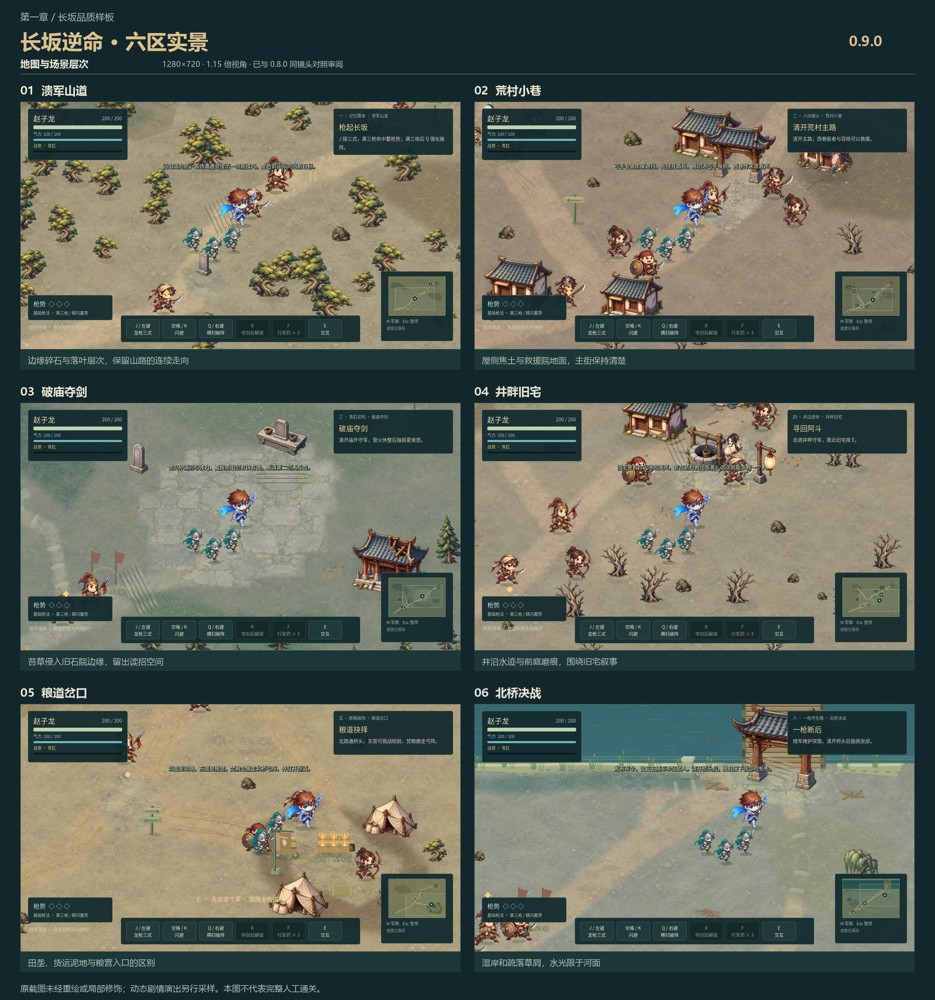

# 第一章品质样板 · 0.9.0

目标是将长坂第一章的动作、战斗反馈和地图叙事做成后续章节可以沿用的制作标准。约 10–15 分钟是紧凑主路的体验目标，尚不是人工通关实测；保留原有三条可选命运及长坂到汉水的进度衔接。具体结果以开发记录为准。

## 本轮范围

- **角色动作**：保留已经校准的完整原画、方向与脚底尺度，加入腿部交替、躯干重心、出枪压身和收招回正。头脸、长枪维持刚性，不能为了动作夸张重新引入拉脸、断枪和人物忽大忽小。现有美术的网格动作仍需与独立逐帧手绘动画区别说明。
- **输入与命中**：修复慢帧越过衔接边界时的晚按键丢失；保留 0.14 秒缓冲，错误按键不覆盖已经接受的动作。空挥、轻枪、第三枪、精准回枪、盾挡、破盾和破势分别反馈，控制一次挥击的音量叠加。原伤害、精准闪避窗口、气力消耗和四章难度顺序保持。
- **敌人配合**：长坂刀盾靠近不同肩侧，枪兵在待机时维持长兵距离，弓手在建筑遮挡时寻找射线；合法攻击仍受原人数和出手间隔限制。其余章节行为不变。只调整站位不能被当作新增兵种。
- **场景演出**：六区各有地面痕迹与局部烟尘、落叶、水光或暖灯；救援、夺剑与焚粮会改变局部状态。简短地名和结果字幕不阻断操作，不改镜头缩放、不修改存档任务旗标。
- **完成度**：实机对照、输入与命中验证、六区布局和存档衔接检查，再导出相同内容的 Windows/Web 包。预览、自动流程、原生短样本和完整人工通关分别记录。

## 六区节奏

山道用单刀、刀枪、盾弓三组让玩家学会观察出手与切后排；荒村将主路和救援院分开，救出的医者为井畔选择埋下因果。破庙用夏侯恩的快剑与迟重斩检验读招；井宅给短暂喘息，再由玩家决定是否守住医者。粮道将探索价值落实为北桥弓兵减员；北桥保持张郃两阶段与随军护送的断后主题。

新提示仅在接近对应遭遇且没有重要通知时出现；不要求玩家必须按某个技能才能继续，不靠强制无敌或虚假击杀完成教学。

## 地图与局部演出的实际实现

本轮在原有绘画素材上编排六区地面层次，使用 `map_details.json` 的手工材质区域与痕迹，不以全区均匀散点代替构图。材质和田垄离线烘入原六张地表；第一章局部落叶采样尺度调整为原值的 0.45，使草屑与角色脚掌尺度更接近。该尺度只影响第一章，原图像素和其他章节的材质采样保持原样。

| 区域 | 地面构图 | 局部动态与任务结果 |
|---|---|---|
| 溃军山道 | 风化碎石、坡缘落叶、望乡石附近磨痕 | 树缘落叶和沿坡尘粒，主路不叠加遮罩 |
| 荒村小巷 | 屋侧焦土、遗留拖痕、救援院地面 | 屋侧余烟与纸灰；救出百姓后烟减弱，救援点暖光增强 |
| 破庙夺剑 | 苔草侵入旧石院边，保留中心读招区 | 院边落叶、祭台低亮尘粒；夺剑后尘粒减弱 |
| 井畔旧宅 | 井沿湿土、水迹和前庭磨痕 | 小范围水光、旧宅暖灯和布角；救下夫人后灯晕增强 |
| 粮道岔口 | 外侧收割田垄、粮营泥地、运输拖痕 | 截粮前糠屑、截粮后余烟与灰烬；变化使用已有 `supplies` 旗标 |
| 北桥决战 | 湿岸和疏落草屑，保留渡桥通路 | 水光严格留在河面，击败张郃后岸边飘叶减弱 |

`changban_presentation.gd` 由实际 World 创建和切区清理，绘制位于人物、攻击红区和交互提示下方；每区粒子上限 28，20 Hz 重绘且按视野裁剪，不增加物理实体或全屏灯光阴影。`setup(game)` 只读取已有任务状态，`advance(dt)` 接在游戏暂停、死亡和命中停顿守卫之后；局部完成反馈只触发一次，读取已完成存档不会重复播放。原主路、支线、地标碰撞和任务对象坐标不变。

`tools/bake_changban.gd` 只更新第一章六张 1600×1100 地表，使用不读写存档的地图场景，不改共享景物图集或后三章。先烘焙，再导入资源，才能检查最终画面。

开场实景复查另发现山道「望乡石」仍使用早期绿色多边形绘制，已仅将该地标接到现有风化石碑贴图。运行期使用 `stela.png` 的 0.8 相对倍率（实际缩放 0.4），约保持原立石高度；脚点 `(650,738)`、18 像素圆碰撞与地标用途不变，其他石碑实例不改变。该修复属于竖立景物绘制，无须重新烘焙地表。专测增加贴图路径、图像脚点与实际碰撞合同三项后为 **756/0**，地图 491/0、绘画资源 290/0、旧氛围 194/0 再通过；日志为 `.qa/v090-cairn-reviewed-*.log`。首次新增断言将 JSON 浮点与整数字符串比较而失败，`.qa/v090-cairn-foot-diagnostic.log` 保留了实际相同数值，改为数值精确比较后复验；原失败未覆盖。

本轮地图逻辑最终证据：`changban_presentation_verify` **756/0**，覆盖真实 World 唯一实例、切区、命中停顿冻结/恢复、暂停/死亡、随机数隔离、已有任务回读、水面边界及望乡石绘画贴图合同；`map_verify` **491/0**，含 16 次区域衔接与约 48,643 像素实际碰撞行走；`atmosphere_verify` **194/0**。首次初始化 UI 尚未创建的错误日志保留于 `.qa/v090-map-presentation-first.log`，修复后分别以 reviewed/world-integration/final 前缀复验。落叶尺度修改后的 753/0、491/0、绘画资源 290/0 保留为阶段证据；这些数值证明对应逻辑或资源约束，不代替画面审阅与人工通关。

固定镜头对照先逐一审阅六区及夏侯恩蓄势场景，发现新落叶材质尺度偏大，再调整第一章采样尺度并重烘焙；随后将望乡石接入现有绘画石碑。最终 `map-identity-v090-release-manifest.json` **17 张、0 自动失败**，开场专项 `changban-quality-v090-release-opening.png` 再确认地标贴图与脚点。六区图审阅未见新增的纹理断层、攻击红区遮挡或地形穿脚；下图使用 release 标签的最终六区，原 final/after 标签及修改前证据继续保留。修改前后十二张源截图的字节哈希保持不变；动态剧情状态需结合额外场景采样判断，不能从这些静帧推断连续动作或通关体验。

## 本轮验收快照

- 最终完整回归为 **38组、109,421项断言、0失败、0脚本错误**（`.qa/v090-full-release.log`），包含稳定肩侧、浮字避让与绘画立石。首次整合109,411项日志保留；收尾专项19/0、88/0、756/0也另有记录。根检查脚本现在也会因SCRIPT ERROR失败，不仅检查进程退出码。
- 最终 `changban-quality-v090-release-manifest.json` **11图/0失败**覆盖开场、真实第三枪／破盾／精闪回枪、救人／夺剑／焚粮状态、井宅营救和张郃二阶段。首轮浮字叠状态条已修复；冻结QA中的加速击败校尉站尸通过捕获前推进真实死亡视觉修正，不改生产伤害，旧图保留。
- [赵云动作前后动态对照](images/zhaoyun-motion-0.9.0.gif) 由前后各140帧真实捕获制作，7秒、20FPS；280张源PNG哈希未变。这是四方向归格动作采样，沿用原画／网格，非新绘独立逐帧素材、非实战录像。靴底偏移阈值在单位角色缩放的游戏坐标中检验，不承诺任意分辨率的固定屏幕像素误差。
- `.qa/changban-performance-v090-release.json` 三场原生短样本有效，真实渲染3055/2844/2704帧，0最小化、非低样本，P95帧间隔2.015/2.293/1.848ms。实际接触、井畔救援和张郃原生半血均发生；延长生命维持负载，监视器每秒峰值不等同逐帧耗时，没有网页或长时流畅度结论。首轮最小化导致的渲染等待已记录，恢复后捕获完成，新预览有5秒渲染等待上限。
- 最终Windows与Web已导出并做本地检查：PCK197资源/17JSON、24区/29敌军，四个新专项在实际包内通过；Windows90帧启动退出0，ZIP完整性通过。网页已检查首章进入、移动出枪、军图与暂停。准确字节数／哈希及Git／Pages结果统一见 [发布记录](../CLOUD-POLISH.md)，不重复维护两份指纹。

## 验收边界

任何动作改动必须同时检查脚底、人体比例、面部与兵器刚性、切帧邻居排除和连续时间。地图装饰必须不挡住实际攻击红区或主支路，不增加无限刷兵和每帧高成本离线绘制。暂停、死亡和顿帧时，局部演出与战斗一起冻结。旧存档、战报和后三章必须回归。

最终截图、测试、包指纹、在线验证和仍需人工试玩的事项，由 [开发与发布记录](../CLOUD-POLISH.md) 汇总。
