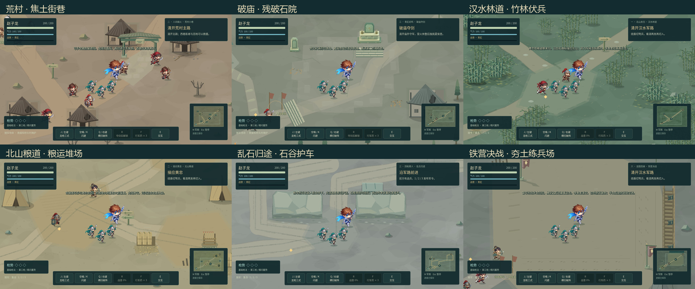

# 《龙胆：逆命三国》双章地图美术规范（0.5.0）

本规范约束 Godot 电脑版十二个区域的地图制作。玩家应能从路线形状、脚下材质、植被轮廓和一处与剧情相关的地标辨认所在区域；关卡名和界面文字只是辅助。战斗与互动区域保持低对比度，装饰集中在道路边缘、建筑脚下和水岸。所有固定地表由源码烘焙，运行时只绘制贴图、实体和有限的动态氛围。

2026-10-23 更新：本轮沿用 0.4.0 的分区身份与坐标，接入内置 `image_gen` 生成的环境原图。原始 PNG、最终提示词、alpha 连通抽帧和 Godot 烘焙方式见 [PAINTED-ENVIRONMENT.md](PAINTED-ENVIRONMENT.md)。新增资产完整性检查并入二十二组回归；本轮源码与原生截图结果见 [Godot 开发说明](../godot/README.md)，导出和线上验收仍待完成。



上图是 **0.4.0 历史截图**，用于说明分区方向，不是 0.5.0 的最终像素或验收结果。当前画面仍须按正常 1.15 倍率逐张检查角色、预警和地标，缩略联系表不代替实际游戏尺寸的复核。默认在线首页已统一进入 Godot；`legacy.html` 是旧 Canvas 原型，不能用它判断当前地图。

## 十二个区域的身份

| 区域 | 主轮廓与行进方向 | 地表、植物 | 必须读出的叙事依据 |
| --- | --- | --- | --- |
| 溃军山道 `mountain` | 山脊挤出的曲折撤退路，石阶接向营火 | 干土、裸露页岩层理、稀疏风蚀树与枯草 | 望乡石、弃军痕迹和山脊营地说明赵云正逆着溃军返回战场；不画均匀森林公路。 |
| 荒村小巷 `village` | 主街分出通往救援庭院的窄巷 | 烟熏土、残缺街石、少量枯树；焦痕贴近受损屋基 | 坍屋、门楼、草棚与通往医者的拖痕让“村中有人待救”先于任务文字成立。 |
| 破庙夺剑 `temple` | 破门、石阶、偏轴庭院导向祭坛 | 受侵蚀的旧石面、裂缝、边角苔痕与柏树 | 旧碑、祭坛和断续的祭道说明这是被战火毁坏的庙宇；决斗空地须平整可读，不用完整对称竞技场图案。 |
| 井畔旧宅 `house` | 道路收进有门槛的井庭，再通往北行出口 | 被踩旧的院石、井水痕、布席与少量枯树 | 井架、糜夫人附近的生活遗物与担架拖痕暗示救援发生在民宅；院中不能长成树林。 |
| 粮道岔口 `fork` | 北桥直路与粮营支路一眼可分 | 压实土、支路双轮辙、散落稻秆；营内树极少 | 双向路牌、粮架、营旗和油车体现“直赴北桥或袭粮营”的选择。 |
| 北桥决战 `bridge` | 河岸、桥头门楼、撤离线形成纵深 | 被踏平的滩地、潮湿碎石与桥头残石；柳树留在岸边 | 缆桩、桥板和开阔决斗区承接掩护渡桥；让河与桥决定构图，不用普通草场贴一条水带。 |
| 汉水林道 `hs_forest` | 竹带夹住军路，两翼留可识别的切入缺口 | 湿土、林间碎石、成组竹竿与竹叶影 | 斥候伏击依赖遮蔽与侧袭；路口清场要让敌人和箭路可读。 |
| 北山粮道 `hs_grain` | 车路穿过接应点，通往粮车回程 | 压实粮道、成向车辙、稻壳和低矮灌丛 | 黄忠、粮架与粮垛组成后勤节点；不能只在空旷十字路旁孤立摆一个粮架。 |
| 乱石归途 `hs_return` | 石壁围出护车主线与救伤兵侧线 | 冷灰页岩、碎石、车辙与少量灌丛 | 两条路的风险不同，伤兵棚应成为侧路终点；石壁必须按已有实体边界表现，不能在角色前铺一整块遮脸纹理。 |
| 孤营大门 `hs_camp` | 藏兵区、门洞、鼓台沿计策动线展开 | 夯土操场、门前磨损地与极少营外灌丛 | 青旗、营栅与战鼓指向“藏兵—开门—退敌—擂鼓”；营内保留清晰的队列与通路。 |
| 河湾反击 `hs_river` | 河岸嵌入追击路线，船架与木料构成掩体 | 湿岸泥地、岸边苇草、较疏的柳树 | 船架、缆桩、木堆都依附水边，解释追击与弩箭遮挡；水域应参与视线构图。 |
| 铁营决战 `hs_final` | 栅栏、军帐和旗位围出不规则决战空地 | 被反复踩实的军营土、破损铺地与极少枯树 | 铁营的阵地压力来自围合与受损军械；保留 Boss 招式辨识空间，避免与破庙共用八边形砖场。 |

## 可编辑源与坐标边界

- `godot/data/chapter1.json` 与 `godot/data/chapter2.json` 给出剧情入口、道路、交互物、敌群、竞技区和第二章布局。`godot/data/map_details.json` 是第一章局部地表、地标与碰撞的补充来源。0.5.0 继续沿用现有通行、碰撞、寻路及剧情坐标；纯绘画痕迹不能被误读为挡路的高墙。
- `godot/scripts/terrain_materials.gd` 定义每区土色、道路宽度、地表植物笔触、树种和保留密度。道路与植物须服务地貌和行军用途；低对比细纹只在有依据的区域出现。
- `godot/art_source/painted/` 保存环境原画与最终提示词，`props-manifest.json` 定义连通抽帧种子、脚底与占地宽。`painted_props.gd` 仅在烘焙时读取这些源，生成 `scenery.png`、`hanshui_props.png` 及地标贴图；`scenery_styles.gd` 保留旧剪影和未覆盖物件的后备。场景仍按风蚀树、枯树、柏树、柳树、竹林和灌丛区分，房屋与军帐保留原脚底锚点及实体占地。
- `painted_ground.gd` 把六种地表原图用于既有地表多边形，混入区域底色、按边缘渐隐，并在离线阶段处理接缝和重复。正式地图只有烘焙 PNG，不逐帧运行原画材质 shader。不能用新增材质多边形悄悄改变导航或实体范围。
- 第一章手工地表在 `godot/scripts/map_details.gd`：山脊石层、村街烧痕、庙庭裂缝、井庭生活磨损、粮营车辙和桥头踩踏均画在地面。第二章材料与叙事笔触在 `godot/scripts/hanshui_layout.gd`，局部图形必须贴合 `chapter2.json` 的 `layout`、水域及现有 `solids`。
- `godot/tools/bake_painted_landmarks.gd` 用新原画生成祭坛、旧碑、粮架和灯柱，原资源路径、尺寸、脚底与碰撞元数据保留；新增门楼/井进入四帧 `painted_markers` 图集。`godot/art_source/map_landmarks.blend` 与 `regenerate_landmarks.py` 保留为旧 Blender 方案。执行旧再生脚本会覆盖四张当前地标，发行前须重新执行绘画地标烘焙。

## 禁止退回的画法

1. 不得在整张图均匀随机撒草、树、石子、瓦砾或光点来填空。细纹可以由固定种子生成，但必须受道路、林带、水岸、屋基等明确区域约束；战斗中心优先留白。
2. 不得用相同规则砖地、完整几何多边形或同一条等宽双车辙道路换色充当另一关。先改变空间轮廓与材质用途，再考虑色差。
3. 不得在可走路面画无碰撞高墙、树干或码头实体，也不得移动现有实体而不同步碰撞、导航、箭路与剧情交互。平面的裂缝、阴影、布席和水痕必须保持可通行的视觉语义。
4. 不得直接修饰导出的地图 PNG 作为唯一源文件；修改应回到原画/提示词、抽帧清单或 Godot 可编辑绘画源并重新生成。旧 Blender 模型属于历史回退管线，不应无记录地覆盖当前绘画版。

## 重建与待验收项目

修改原画、抽帧清单或可编辑地表后，先烘焙绘画地标并导入新贴图，再生成第一章地表/共享景物和第二章地表/汉水图集。随后再次导入更新贴图，进行图形截图、碰撞与路线核对。三个烘焙步骤需本机可用的 Godot 图形渲染器：

```powershell
godot --path godot --script res://tools/bake_painted_landmarks.gd
godot --headless --path godot --editor --import --quit
godot --path godot --script res://tools/bake_maps.gd
godot --path godot --script res://tests/hanshui_layout_verify.gd -- --bake
godot --headless --path godot --editor --import --quit
```

烘焙完成后，使用 `godot/tests/map_identity_preview.gd -- --label=唯一标签` 检查十二关和五个战斗/任务状态。该入口保留正常 1.15 镜头，验证赵云脚点在真实可走地形上，并等待景物遮挡淡出稳定；旧 `theme_preview.gd` 只保留为历史参考。首先看路线与剧情地标，再看角色、红区和箭路；对照 `map_verify.gd`、`hanshui_layout_verify.gd`、`hanshui_world_layout_verify.gd` 及修改前保存的本地 `map_identity_verify` 基线。`painted_assets_verify.gd` 另外验证正式贴图与脚底契约，在导出 PCK 上也不依赖原画目录。源码、资产完整性和历史截图均不能代替本轮实画面验收；Web 仍需重新导出、部署并检查。
